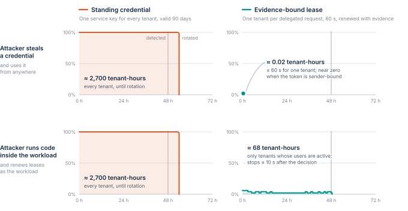

# Verified Compute Fabric

A reference architecture for evidence-bound authority and breach containment.

**Status:** proposed reference architecture, version 2.0, 24 October 2026.
It is a design and a test plan.
It is not an implementation, a benchmark or a certification.

**Read it:** [PDF, version 2.0](releases/v2.0/Verified_Compute_Fabric_v2.0.pdf) · [Section by section on GitHub](spec/README.md) · [Executive brief](spec/00-brief.md)

Co-Authored with Human Assistance from: **Gabe Fletcher**.
Version 1.0 was drafted with ChatGPT (OpenAI).
Version 2.0 was revised and extended with Claude (Anthropic).

## The idea

> A workload’s authority should come from authenticated evidence and a current, resource-specific policy.
> Compromise must not give the workload control over the boundaries that contain it.

Large breaches rarely need a large first foothold.
They need authority that is broad, long-lived and controlled by the thing that was compromised.
Verified Compute Fabric limits that authority, so the damage a breach can do becomes a number you can compute and test.

1. **Prove what runs.** Approve exact code and launch configuration, record the approval in a public log, and bind evidence of that release to the running instance.
2. **Grant per operation.** Authority names a resource, an action, a tenant and an audience. Identity alone grants nothing.
3. **Make every grant expire.** Leases are short. Renewal needs fresh evidence. No grant outlives the authority that issued it.
4. **Enforce from outside.** Decisions are checked where the workload cannot reach: a gateway, a database policy, a protected-guest supervisor, an off-host broker.
5. **Keep recovery out of reach.** Restoring trust must work when production identity, policy and administrator accounts are gone.

*Illustrative model from [§1](spec/01-why-breaches-spread.md): exposure falls from about 2,700 tenant-hours with a standing key to about 68 with evidence-bound leases.*

## This repository is the source of truth

- The concept lives in [`spec/`](spec/), one Markdown file per section. Changes are made there.
- Every cited source lives in [`references/references.yaml`](references/references.yaml), with the date it was last checked.
- Figures used by the text are in [`figures/`](figures/).
- [`releases/`](releases/) keeps copies of the published PDFs for reference. Version 1.0 is kept unchanged for the record.
- Changes go through pull requests, as described in [CONTRIBUTING.md](CONTRIBUTING.md). Versions are listed in [CHANGELOG.md](CHANGELOG.md).

## License

[Apache License 2.0](LICENSE). See [NOTICE](NOTICE) for copyright and the use of the name.
