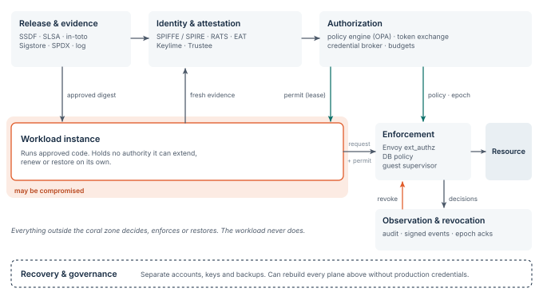

# Control planes and trust boundaries

The architecture gives responsibility to six logical planes ([Figure 2](../figures/planes.svg)).
A small installation may run several planes on shared infrastructure, but it must keep the trust boundaries it claims.
NIST separates the policy decision from its enforcement, and its cloud-native guidance applies identity-based controls to distributed services.
Google’s BeyondProd describes the same shift for its own microservices: trust follows verified workload identity and code provenance, not network location. [@nist-zta; @nist-zta-cn; @beyondprod]

**Figure 2.** The six planes.
Release & evidence supplies reference values to the verifier.
The verifier hands an appraised identity to authorization.
Authorization issues leases to the workload and policy epochs to enforcement.
Observation & revocation acts on enforcement directly.
Recovery stands outside production authority.

The figure is a proposed composition.
Installing the named components does not by itself make them compatible or give the required properties.
An integration defines the identity mapping and the evidence profile, then proves that every sensitive request crosses an effective enforcement point.

## Resource-boundary enforcement

The protected resource trusts its gateway or its native authorization mechanism.
It never accepts an application’s statement that admission succeeded earlier.
A backend that can be reached directly is a separate access path.
It must apply equivalent checks or be made unreachable.

## Independent trust domains

Organizations run local trust domains.
Federation names the issuers a domain accepts and the exact resources they may address.
Federation is not transitive unless explicitly authorized: trusting a partner does not mean trusting the partner’s partners.
No universal internet identity provider or global blocking authority is required.

> [!NOTE]
> **Architectural invariant.**
> The authorization service can reduce or end a workload’s authority without that workload’s cooperation.
> The selected profile states whether the host’s cooperation may be assumed.
