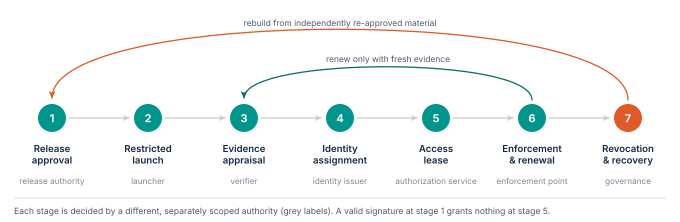

# Separate approval, admission and permission

A deployment ties evidence to one running instance.
Release approval, admission and per-operation authorization are separate decisions, each made by a separately scoped authority ([Figure 3](../figures/lifecycle.svg)).
An approved artifact does not get broad access just because its signature verifies.

**Figure 3.** The evidence-bound lifecycle.
Renewal returns to evidence appraisal, so authority cannot be extended without fresh evidence.
Revocation leads to a rebuild from independently re-approved material, not to a restart of the compromised instance.

| Stage | Required decision or binding |
|---|---|
| 1. Release approval | Bind the source revision, immutable artifact digest and configuration to an approved release manifest, recorded in a transparency log. |
| 2. Restricted launch | Start without production secrets. Allow only the bootstrap dependencies needed for verification. |
| 3. Evidence appraisal | Check freshness and the selected execution profile. Bind the evidence to the instance’s authenticated channel key. |
| 4. Identity assignment | Map the verified instance to its approved logical workload and tenant. Reject self-selected identity claims. |
| 5. Access lease | Authorize a bounded resource action with an audience, an expiry, a budget and the current policy epoch. |
| 6. Enforcement and renewal | Evaluate each request and end expired sessions. Require acceptable evidence before renewal. |
| 7. Revocation and recovery | Stop issuance, cut existing authority and rebuild from independently re-approved material. |

## The five design rules, in practice

1. **Prove what runs.** A release manifest names the exact code and every security-relevant setting.
   A mutable image tag cannot identify an approved executable.
   Runtime-loaded plugins, mounted code and privileged start-up steps belong to the reviewed launch contract.
2. **Grant per operation.** A workload acts for a specific tenant or authenticated user when the operation needs one.
   Service identity never supplies missing business authorization.
3. **Make every grant expire.** Every grant has a lifetime and a scope.
   Long-running sessions get an independently enforced deadline.
   Delegated authority never outlives the authority that issued it ([§15](15-revocation.md)).
4. **Enforce from outside.** A revocation path survives the compromise it is meant to contain.
   Containing host root needs an off-host resource boundary or an applicable protected execution boundary.
5. **Keep recovery out of reach.** What is needed to rebuild a trusted state stays reachable when production identity and policy services are not.

These are integration requirements.
The supply-chain and attestation mechanisms that implement them keep their own trust assumptions. [@rats; @in-toto]
