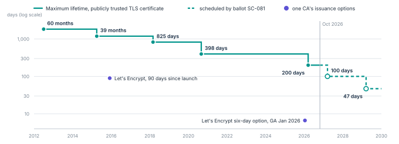

# Issue narrow, renewable authority

SPIFFE defines workload identifiers and identity documents.
SPIRE issues them using node and workload attestation, including selectors derived from the local platform.
A SPIRE identity is not, by itself, hardware evidence that the host is uncompromised.
Its assurance depends on the components that assigned it. [@spiffe; @spire]

## Logical identity and instance binding

Give each service role one logical identifier within a trust domain, with explicit tenant and environment boundaries.
Record each instance separately.
A permit binds the instance to its logical identity, release digest and evidence profile.
The application cannot claim another tenant’s identity through an environment variable or a request header.

People use phishing-resistant authentication suited to the assurance level; NIST recognizes cryptographic authenticators that resist phishing.
Human and workload principals stay separate.
Emergency administration needs independent approval and audit. [@sp800-63b]

## Credential brokering

Applications ask a broker for an operation or a short-lived credential.
The broker validates the workload identity and the delegated user context.
Credentials are scoped to an audience and an action.
The broker never exposes an unrestricted signing or decryption endpoint.

Where issuer and resource both support it, use certificate-bound OAuth access tokens or DPoP sender-constrained tokens.
Both bind the use of a token to possession of a key.
They do not help against a compromised caller that holds the key, or a provider endpoint that skips the check. [@oauth-mtls; @dpop]

For an external API that accepts only a long-lived key, keep the key in the broker.
The application submits a typed operation.
The broker enforces destination and action limits, a tenant scope and a usage ceiling.
It must not become a general HTTP relay.
A provider credential that can bypass the broker needs its own containment plan.

## Delegation that can be audited

When a service acts for a user through another service, exchange the token instead of forwarding it.
OAuth 2.0 Token Exchange records the acting party in an actor claim, so the chain of delegation stays visible.
Resource indicators restrict a token to one audience.
Rich Authorization Requests carry typed, fine-grained permissions such as “export customer records for tenant A”. [@token-exchange; @resource-indicators; @rar]

## The issuer is part of the credential

A token is only as narrow as the issuer that signs it.
In the Storm-0558 intrusion, a consumer signing key created in 2016 was used to forge tokens that enterprise mail services accepted.
The review board found the key should have been retired years earlier.
Give each issuer a stated scope and a short validity, and have resources reject tokens from issuers outside that scope. [@csrb-storm]

## Authority separation

Identity says who is calling.
A lease says which operation is allowed.
The application must also establish whose data the operation concerns.
Database credentials never turn a verified service identity into access to every tenant.

## The public web is moving the same way

Short lifetimes are replacing revocation lists on the public web.
CA/Browser Forum ballot SC-081 cuts the maximum lifetime of a publicly trusted TLS certificate from 398 days to 47 days by 2029, and Let’s Encrypt shut down its OCSP service in 2025 and now offers six-day certificates ([Figure 4](../figures/certlife.svg)). [@sc081; @cabf-br; @le-ocsp; @le-short]

**Figure 4.** Maximum lifetime of a publicly trusted TLS certificate, by issuance date.
Values: 60 months from July 2012; 39 months from April 2015; 825 days from March 2018; 398 days from September 2020; 200 days from 15 March 2026; then 100 days (2027) and 47 days (2029) as scheduled by ballot SC-081.
Violet points: Let’s Encrypt’s 90-day default and its 160-hour certificates, generally available in January 2026.

> [!NOTE]
> **Proposed initial settings.**
> A pilot may begin with five-minute workload certificates and 60-second leases for sensitive operations.
> These are engineering starting points, not published best practice or measured safe limits.
> Test renewals and session deadlines under load and during partitions.
