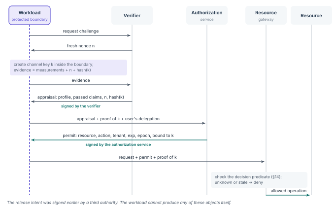

# Bind evidence to an enforced launch contract

The RATS architecture separates an attester, which produces evidence, from a verifier, which appraises it, and a relying party, which decides.
EAT provides a claims format that profiles can adopt.
Neither defines a safe workload.
The relying party needs explicit claim semantics and trusted reference values. [@rats; @eat]

## Freshness and channel binding

A verifier challenges an instance with a fresh nonce.
The evidence is tied to the intended audience and to a channel key generated inside the protected boundary when that protection is claimed.
The broker checks possession of that key.
A report copied from another instance must not release credentials ([Figure 5](../figures/sequence.svg)).

**Figure 5.** Evidence binding.
The channel key *k* is created inside the protected boundary and named in the evidence, the appraisal and the permit, so none of them can be replayed by another instance.
Three different authorities sign the release intent, the appraisal and the permit.

A hardware-signed field that carries an application-supplied digest is not enough on its own.
A measured, trusted supervisor must enforce the link between that digest and the code actually loaded.
Otherwise a malicious host can quote an approved hash while running different software.
This follows from the gap between authenticated evidence and the truth of the state it claims.

## Two implementation paths

**Managed-host path.** TPM-backed boot measurements and Linux IMA measurements support integrity appraisal through Keylime.
Coverage depends on what is measured and how trustworthy the measurement path is; measured files do not describe every in-memory action.
A 2025 case study of Keylime found operational false positives and detection gaps under its test conditions.
That motivates explicit coverage tests, not a claim that every deployment shares those defects. [@keylime-ima; @keylime-dsn]

**Host-adversarial path.** AMD SEV-SNP, Intel TDX and Arm CCA supply evidence for applicable confidential guests.
Trustee provides an attestation and key-broker architecture.
Confidential Containers documents guest-enforced policy and Init-Data binding that limit what the host may request from a protected guest.
The chosen integration must show that the attested supervisor enforces the approved image and configuration. [@snp; @tdx; @arm-cca; @coco-attest; @coco-secure]

## Reference-value governance

Reference values come from an approved release process.
They are never accepted because a host happens to be running them.
Keep approved firmware and trusted-base versions, with a deliberate window for patches.
Update verification collateral, and retire vulnerable measurements when policy requires.

> [!NOTE]
> **Continuous evaluation has limited coverage.**
> Repeated appraisal detects the changes its evidence represents.
> It cannot prove continuous benign execution.
> Publish what each evidence profile observes and which changes remain invisible.
