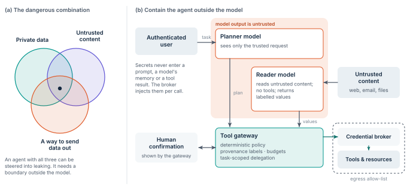

# Treat AI agents as workloads with untrusted control flow

An AI agent is a workload whose next action is chosen by a model reading its inputs.
That makes its control flow steerable by data.

Prompt injection — instructions hidden in a web page, an email or a file — is first on the OWASP list of risks for LLM applications.
NIST’s adversarial machine-learning taxonomy treats indirect prompt injection as its own attack class.
Filters and model training lower the risk.
They do not remove it. [@owasp-llm; @nist-aml]

The answer is the same as for any untrusted workload: decide and enforce outside it.
The model proposes.
A deterministic gateway decides.

## The dangerous combination

An agent becomes dangerous when it has three things at once: access to private data, exposure to untrusted content, and a way to send data out ([Figure 6a](../figures/agents.svg)).
Each is often harmless alone.
Together they let a hidden instruction read a secret and post it somewhere else. [@trifecta] Remove one of the three for a task whenever you can.
Where all three are needed, the boundary in [Figure 6b](../figures/agents.svg) is required.

**Figure 6.** Agent containment. (a) The combination that makes an agent exploitable. (b) The planner sees only the trusted request.
Untrusted content goes to a reader that cannot call tools.
A deterministic gateway checks every proposed call against policy and provenance before a broker attaches credentials.

## Rules for agent authority

1. **No ambient credentials.** Secrets never enter a prompt, a model’s context or memory, or a tool’s output.
   Tools call a credential broker that attaches scoped credentials per call.
2. **Authority follows the user’s intent.** The agent acts under a task-scoped delegation from the authenticated user, issued through token exchange with the agent named as actor.
   It is short-lived and lists typed actions.
   A sub-agent gets narrower authority than its parent, never equal. [@token-exchange]
3. **Separate planning from untrusted data.** The plan comes from the trusted request.
   Untrusted content is read by a component that cannot call tools and returns values marked with their source.
   CaMeL shows the pattern: a privileged model writes the plan, a quarantined model parses untrusted data, and an interpreter tracks where every value came from and enforces policy at each tool call. [@camel]
4. **Deterministic policy at the gateway.** The gateway sees the action, its arguments and the source of each argument.
   Typical rules: untrusted data may not choose a recipient, a destination URL or a command; data from one tenant may not flow to another; every outbound send draws on a budget.
5. **Confirm irreversible actions.** Payments, deletions, external messages and permission changes need human confirmation.
   The gateway, not the model, shows the real parameters.
6. **Egress is part of reach.** Network egress from agent tools is allow-listed.
   Allowing an entire shared hosting domain is not an exfiltration control.
7. **Instructions are code.** System prompts, tool manifests and MCP server configurations are versioned, reviewed and released like code, with digests in the release envelope.
   A changed instruction is a new release.

## MCP servers are resources

A Model Context Protocol server is a workload with its own identity and its own authorization.
The current MCP authorization specification builds on OAuth 2.1.
Servers publish protected-resource metadata, clients name the target server with a resource indicator, and a server may not accept or pass through tokens issued for anyone else.
Treat each server as a resource behind its own enforcement point, and give it the narrowest tool filter the task allows. [@mcp-auth; @mcp-sec; @prm; @resource-indicators]

> [!NOTE]
> **Agent exposure.**
> For an agent, Reach is the union of its tool scopes, $`\rho`$ is its tool-call budget, and $`W`$ is the task lease.
> A well-contained agent can still do whatever the user’s delegation allows.
> Containment bounds everything else.
