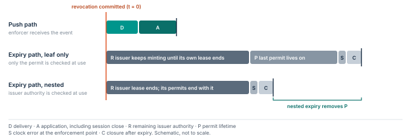
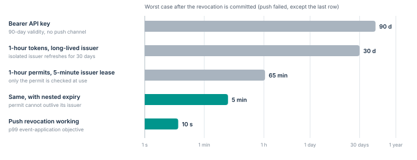

# Bound access after a revocation decision

Certificate lifetime, token lifetime and the lifetime of an established session are separate quantities.
A short-lived certificate does not end an existing TLS session.
The fabric MUST put an authorization deadline on sensitive sessions and have a tested way to close them.

## Revocation transaction

A scoped revocation commits a new policy epoch and stops new permits for the affected subject.
Enforcement points receive the event and acknowledge it.
Resource gateways close affected sessions, and an independent network control may quarantine the instance.
A path that has not acknowledged stays visible as open until its earlier permits expire.

The target set includes every gateway and resource replica that can authorize the operation.
A signed event is not evidence that enforcement happened.
The audit record distinguishes the event’s creation, its receipt and the effective denial.
A compromised issuer needs its trust relationship rotated; revoking one workload identity is not enough.

## Conditional containment bound

```math
T_{\text{stop}} \;\le\; \max_{p \,\in\, \mathcal{P}}\ \min\!\big(D_p + A_p,\;\; H_p + S_p + C_p\big)
```

$`T_{\text{stop}}`$ is the time from a committed revocation until every covered path $`p`$ rejects the affected authority.
$`D_p`$ is event delivery and $`A_p`$ is application, including session closure.
$`H_p`$ is the *expiry horizon*: how long valid authority can still exist on the path if the push fails.
$`S_p`$ is clock error at the enforcement point, and $`C_p`$ is the delay from expiry to closure.
An unavailable push path has an unbounded $`D_p`$, so the expiry term decides ([Figure 7](../figures/revtimeline.svg)).



**Figure 7.** The two ways a path stops honouring revoked authority.
Push stops it after delivery and application.
Expiry stops it when the last valid permit runs out.
Checking the issuer’s authority at use (nested expiry) removes the permit lifetime *P* from the expiry path.

## The expiry horizon depends on what is checked at use

Let $`R_p`$ be how long an issuer that never hears the revocation keeps its own authority, and $`P_p`$ the maximum permit lifetime.
If only the permit is checked at use, a cut-off issuer can mint a full-length permit at the last moment.
If the enforcement point also checks the issuer’s authority at use, as X.509 path validation checks the validity of every certificate in a chain, no permit can outlive its issuer: [@rfc5280]

```math
H_p^{\,\text{leaf only}} \;\le\; R_p + P_p \qquad\qquad H_p^{\,\text{nested}} \;\le\; R_p
```

The issuer’s own clock error drops out of both bounds when the issuer stamps permit expiry with the same clock it uses to check its own lease: if that clock runs late, the issuer mints late but writes an equally early expiry.
Clock discipline matters most at enforcement points, which is where $`S_p`$ sits.

Nested expiry has a practical benefit beyond the bound.
Permit lifetime stops mattering for revocation, so permits can be cached longer for performance while issuer leases stay short.
The lever that remains is $`R_p`$.
An issuer whose signing key lives for months offers no useful expiry bound at all ([Figure 8](../figures/stoptime.svg)).



**Figure 8.** Worst-case time until revoked authority stops working, by design. *Illustrative parameters:* 1 s clock error at enforcement, 5 s session closure, 10 s p99 event application when push works.
Short issuer leases bring the fallback bound from weeks to about an hour.
Nested expiry brings it to minutes and makes the 1-hour permit lifetime irrelevant.

This is a proposed analytical bound, not an empirical result.
It assumes complete path coverage, trustworthy deadline enforcement and a bounded lifetime for every issuer’s authority.
Detection and decision time come on top.
An uncovered backend path or a compromised enforcement boundary invalidates the bound.
Data already read and transactions already committed are not reversed.

## Illustrative pilot objectives

A pilot can test a 60-second maximum lease for sensitive operations, a five-minute issuer epoch lease, nested expiry at every gateway and a 99th-percentile event-application target below 10 seconds.
These are test objectives, not performance claims.
Capacity tests include reconnect bursts and simultaneous credential renewal.

> [!NOTE]
> **Active streams and transactions.**
> Define how a revoked long-running export or database operation is cancelled.
> Disconnecting a client may not undo a transaction the backend has already accepted.
> Cancellation behaviour and partial-result handling belong in the resource contract.
