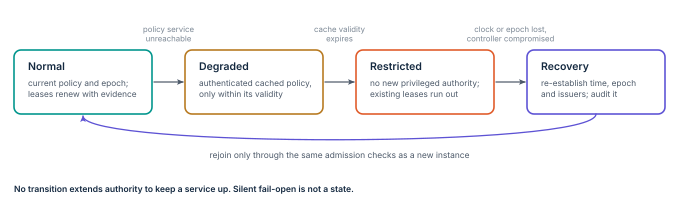

# Preserve policy during outages

An access system is incomplete until it says how it behaves during partial failure ([Figure 9](../figures/failure.svg)).
Availability choices are recorded per resource.
Silent fail-open behaviour for privileged operations is prohibited.

**Figure 9.** Failure states.
Each transition reduces authority or holds it at its existing deadline; none extends it.
Recovery returns to normal only through the admission checks a new instance would face.

| Failure condition | Required behaviour |
|---|---|
| Identity issuer or attestation verifier unavailable | Issue no new elevated authority. Existing bounded permissions continue only until their previously authorized deadline. |
| Policy service unreachable | Use authenticated cached policy only within its approved validity. Deny new privileged access when that validity expires. |
| Policy signature fails, or epoch decreases | Reject the update. Keep the last acceptable policy only while it remains valid, and raise an operator-visible incident. |
| Revocation channel partitioned | Expire permissions locally and end covered sessions. Never silently extend authorization to preserve service. |
| Clock integrity or persisted epoch lost | Enter a restricted recovery state. Re-establish trusted time and policy state before granting new sensitive authority. |
| Audit destination unavailable | Use protected, bounded buffering. Deny operations whose policy requires durable audit before execution. |
| Enforcement controller compromised | Revoke its authority from an independent boundary and start the clean recovery process. |

## Local decisions and bounded caching

Policy evaluation may run near a protected resource to avoid a synchronous global dependency.
The local evaluator authenticates its configuration and respects lease deadlines.
Envoy’s external-authorization filter is an enforcement integration point; deployments set its failure behaviour explicitly and test every protected route.
Shadow-mode evaluation is not an enforcement guarantee. [@envoy-extauthz]

## The control plane has a blast radius too

On 19 July 2024 a faulty content update for the CrowdStrike Falcon sensor reached millions of Windows hosts at once and crashed them.
The update channel was trusted, privileged and unstaged; the vendor has since committed to canary and ring-based deployment of that content.
Apply this paper’s rules to the fabric itself.
Stage policy and evidence-profile rollouts with canaries, scope automated containment by service or tenant, and keep an independent rollback path.
A single noisy detector never gets the power to disable the whole fleet. [@crowdstrike-rca]

## Bootstrap without circular dependencies

Keep a restricted path to the trust anchors and verification services needed for enrolment.
Recovery never depends only on the identity issuer being recovered.
Document the independent mechanism that restores that issuer, including protected administrative credentials and the network path used during an outage.
Emergency overrides need a named operator and a bounded validity, and they cannot silently remove the audit trail.
