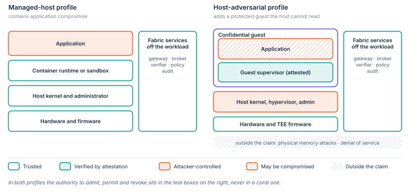

# Declare the protection actually deployed

A profile names who the deployment trusts and who it assumes may be hostile ([Figure 10](../figures/profiles.svg)).
The two profile names are proposed conventions.
Each comes with a versioned conformance statement that lists the actual controls and exclusions.
Hardware attestation is never a cosmetic badge on an otherwise unchanged managed-host deployment.

**Figure 10.** Who is trusted in each profile.
The managed-host profile trusts the host and contains the application.
The host-adversarial profile treats the host as hostile and relies on a confidential guest whose supervisor is verified by attestation; the application inside it may still be compromised.

| Property | Managed-host profile | Host-adversarial profile |
|---|---|---|
| Trusted host | Host administrator, kernel and hypervisor are trusted | Host operator is outside the selected confidentiality and integrity assumptions |
| Execution boundary | Hardened container, or a suitable sandbox or microVM | Supported confidential guest with a trusted guest supervisor |
| Instance evidence | Trusted platform selectors; optional TPM and IMA appraisal | Verified TEE evidence bound to the enforced guest launch policy |
| Credential release | Broker validates identity and the approved release | Off-host broker also validates the confidential execution profile |
| Resource enforcement | Off-workload gateways and native resource authorization | Off-host enforcement or applicable protected-guest enforcement |
| Host compromise claim | No resistance to host root is claimed | Only properties covered by the selected hardware and guest threat model |
| Physical access | Covered by facility security only | Declared: current TEEs exclude memory-bus interposers ([§11](11-hardware.md)) |
| Availability | Independent redundancy and recovery required | Independent redundancy and recovery required |

## Control placement determines the claim

A policy proxy beside the application can contain a constrained application process if the isolation boundary holds.
Host root may control both.
A remote database gateway can still deny that host access if its credentials and administration are independently protected.
A confidential guest may protect internal keys from its host, subject to the hardware model and the correctness of the guest components. [@docker-sec; @snp; @tdx]

## Integration surface

SPIRE, OPA and a gateway provide major building blocks, but the full admission contract needs integration work specific to each implementation.
Trustee and Confidential Containers provide an attestation path for supported environments.
The instance permits, policy epochs, nested expiry and end-to-end revocation guarantees in this paper must still be implemented, or mapped to equivalent supported controls, and tested. [@spire; @opa-bundles; @coco-attest; @coco-secure]

> [!NOTE]
> **Conformance disclosure.**
> A deployment identifies which controls are enforced, which are observed only and which are absent.
> No broad “verified” label may hide a missing workload binding or an unprotected direct path to a resource.
