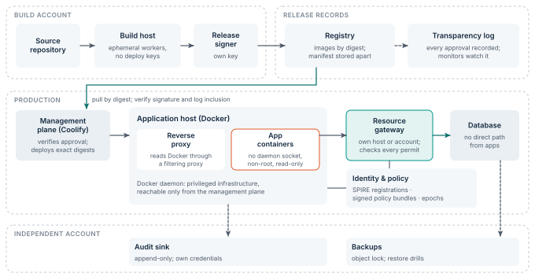

# A Docker and Coolify adoption path

The managed-host profile can guide an incremental Docker-based deployment without a move to Kubernetes.
The table places each boundary; [Figure 11](../figures/topology.svg) shows the topology.
This section is a proposed operating pattern.
It does not claim that stock Coolify implements the full contract, or that any particular live environment has been inspected.

| Boundary | Proposed placement and responsibility |
|---|---|
| Build environment | A separate host for builds. Ephemeral workers produce a signed release envelope and hold no production secrets. Images ship to production by digest; production never builds. |
| Deployment authority | A restricted management service verifies release approval and log inclusion, then deploys exact digests. |
| Application hosts | Supported Docker configuration; non-root, read-only workloads; no application-held daemon authority. |
| Reverse proxy | Reads container metadata through a filtering socket proxy, never the raw daemon socket. |
| Identity and policy services | A protected service boundary; reviewed SPIRE registrations and signed, versioned policy. |
| Sensitive resource gateway | An independent host or account where needed. Validates every permit and blocks backend bypass. |
| Audit and recovery | Independent destination and credentials; immutable retention where appropriate; exercised restore. |

**Figure 11.** Reference topology for a small Docker estate.
Builds run in their own account, approvals land in a transparency log, the management plane deploys only exact digests, and the resource gateway, audit sink and backups sit outside the application host’s authority.
Dashed arrows carry records, not authority.

## Preserve supported operations

Use supported deployment interfaces and external verification hooks.
Any extra adapter needs tests and an upgrade-compatibility policy.
Never present an unsupported modification of a management product as an established security feature.
Where a required enforcement hook does not exist, document the gap and choose a supported enforcement point.

## Management-plane exception

A deployment manager may legitimately need broad Docker control.
Treat it as privileged infrastructure with a restricted administrative path, not as an ordinary application container.
The goal is to stop untrusted jobs and applications from inheriting that authority.
Docker’s daemon security model makes this separation consequential. [@docker-sec]

## First protected business operation

Choose one sensitive operation, such as exporting one tenant’s customer records.
Put the export behind an independent gateway.
Bind each request to a verified service and an authenticated tenant delegation.
Deny the exporter direct database access except where its role really needs it.
Apply a 60-second lease, nested expiry, an export budget, and test forced cancellation.

Expand only after the isolated operation passes its revocation and recovery exercises.
Adding hardware attestation later needs a compatible execution environment and a new evidence profile.
It is never a configuration switch that secures an arbitrary existing VPS.
