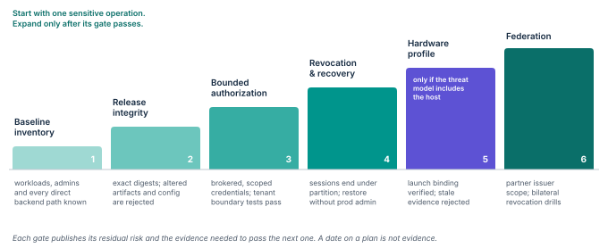

# Advance through evidence-based gates

Roll out by demonstrated properties, not by calendar ([Figure 12](../figures/gates.svg)).
Each stage publishes its residual risk and the evidence needed to proceed.
A deadline does not establish assurance.

## Operating-cost model

The main costs are engineering ownership of policy and evidence profiles, and the availability burden of the identity and verification services.
Other drivers are signature and attestation throughput, certificate-renewal load, audit retention and duplicate recovery capacity.
Hardware procurement matters only for profiles that require it.

An evaluation measures CPU and memory overhead alongside application throughput.
It reports request latency at the median and in the tail, and includes cold start, burst enrolment and mass revocation.
A single microbenchmark is never extrapolated into a claim about fleet-wide security or performance.

## Avoiding a control-plane bottleneck

Replicate issuance and verification services where the security model allows.
Keep resource enforcement able to apply a valid local policy without a synchronous central call on every operation.
Local caching keeps the expiry and anti-rollback rules, and nested expiry lets permits be cached longer without lengthening the revocation bound.
A resilient implementation still denies privileged access once its authorized cache validity ends.

## Procurement convention

Ask each provider or component owner to state the claim semantics it supports and the failure modes it has tested.
“Supports attestation” is not enough without a documented binding to the application that receives the secret.
“Signed images” is not enough without approved signer selection and verification of the image actually launched.

**Figure 12.** Adoption gates and their exit evidence.
Stages 1–4 apply to every deployment.
Stage 5 applies only where the documented threat model requires protection from the host.
Stage 6 adds partners.

> [!NOTE]
> **Investment priority.**
> Fund release verification, enforceable access leases and operation budgets first.
> Adopt the host-adversarial profile when a documented threat model requires protection from host administration and the team can operate its extra trust dependencies.
