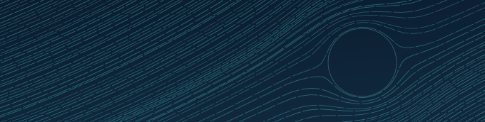

# A tested limit on authority after compromise

Verified Compute Fabric is credible only when every access claim traces to authenticated evidence, an accountable policy decision and an enforceable boundary.

Its deliverable is not a product or a score.
It is a tested limit on the authority that survives a compromise, written as numbers someone else can check: what was reachable, how fast it could be used and how long it lasted.

Version 2.0 adds three things: a way to compute the limit; a rule, nested expiry, that keeps the limit short when revocation messages fail; and coverage of AI agents, the first workloads whose control flow can be steered by the data they read.

This paper proposes the contract and the validation program needed to establish that limit.
It does not claim the limit has been demonstrated.
The next step is to build the first protected operation and measure it.

*Bounded Weave*, seed 1024: the fabric after recovery.
The boundary remains as a faint ring.
